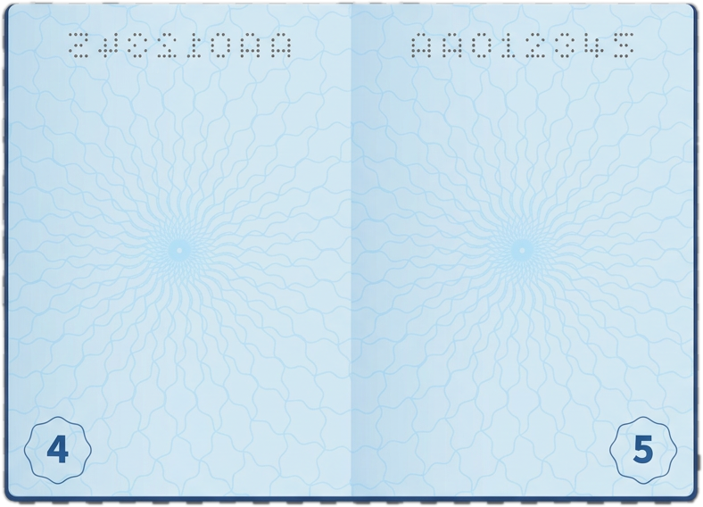
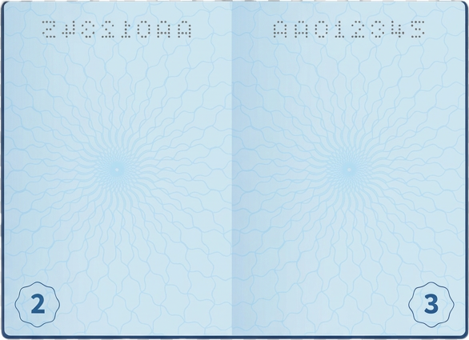
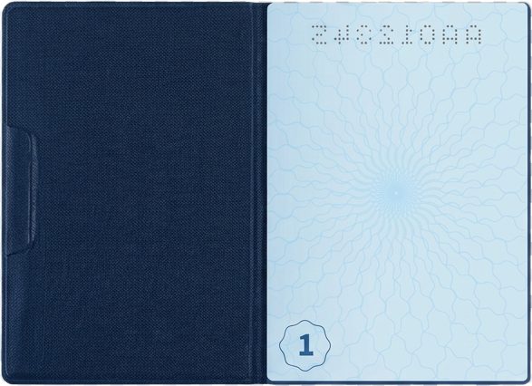

# Bucket List Memories

##### Marco

##### Student Number

###### Design and Development — DV200

<br />

### Bucket List Memories

A social web app where you do not plan a bucket list — you stamp the adventures you have already had.


[Explore the project](#about-the-project) · [View mockups](#mockups) · [Report Bug](#) · [Request Feature](#)

## Table of Contents

- [About the Project](#about-the-project)
- [Project Description](#project-description)
- [Built With](#built-with)
- [Getting Started](#getting-started)
- [Prerequisites](#prerequisites)
- [How to install](#how-to-install)
- [Features and Functionality](#features-and-functionality)
- [Concept Process](#concept-process)
- [Ideation](#ideation)
- [Wireframes](#wireframes)
- [User-flow](#user-flow)
- [Development Process](#development-process)
- [Implementation Process](#implementation-process)
- [Highlights](#highlights)
- [Challenges](#challenges)
- [Reviews and Testing](#reviews--testing)
- [Feedback from Reviews](#feedback-from-reviews)
- [Unit Tests](#unit-tests)
- [Future Implementation](#future-implementation)
- [Final Outcome](#final-outcome)
- [Mockups](#mockups)
- [Video Demonstration](#video-demonstration)
- [Conclusion](#conclusion)
- [Roadmap](#roadmap)
- [Contributing](#contributing)
- [License](#license)
- [Contact](#contact)
- [Acknowledgements](#acknowledgements)

## About the Project



### Project Description

**Bucket List Memories** flips the usual bucket-list concept on its head. Instead of listing things you want to do one day, you log the things you have already done. Each entry is stamped into a personal digital passport with a country, year, category, story, and optional media proof.

The app combines a personal travel journal with a community feed. Users can publish approved memories, filter the feed by country, year, and category, add tags, upload images, videos, or audio, and interact through likes and comments. Each memory can also include up to three next adventures that the community can vote on. Only the owner of a memory can see its live vote totals; other users can vote without seeing the tally.

## Built With

- [PHP 8+](https://www.php.net/)
- [MariaDB / MySQL](https://mariadb.org/)
- [PDO](https://www.php.net/manual/en/book.pdo.php)
- [Bootstrap 5.3](https://getbootstrap.com/)
- Vanilla JavaScript
- HTML5 and custom CSS
- XAMPP for local Apache and database development

## Getting Started

These instructions will get the project running locally with XAMPP.

### Prerequisites

Install the following:

- PHP 8.0 or later
- MySQL or MariaDB
- [XAMPP](https://www.apachefriends.org/)
- A modern web browser

### How to install

1. Place the project folder in the XAMPP web root:

   ```text
   C:\xampp\htdocs\Dv200-bucketlist
   ```

2. Open the XAMPP Control Panel and start **Apache** and **MySQL**.

3. Open [phpMyAdmin](http://localhost/phpmyadmin), select the **Import** tab, and import [`schema.sql`](schema.sql). The script creates the `bucketlist_memories` database and its tables.

4. Check the database credentials in [`db.php`](db.php). The default local configuration is:

   ```php
   DB_HOST = '127.0.0.1';
   DB_NAME = 'bucketlist_memories';
   DB_USER = 'root';
   DB_PASS = '';
   ```

5. Open the application at [http://localhost/Dv200-bucketlist/index.php](http://localhost/Dv200-bucketlist/index.php).

6. Create an account. A user named `admin` is treated as the moderator account and can approve or reject submitted memories from the Admin page.

New memories are submitted as `pending`, so they must be approved before they appear in the public feed.

## Features and Functionality

### Community Feed

The feed displays approved public memories as passport-style cards. Users can filter memories by country, year, and category without reloading the page.

### Stamp a New Memory

Logged-in users can record a completed adventure with a title, country, year, category, story, tags, visibility setting, and up to five uploaded media files. Supported media includes JPEG, PNG, MP4, and MP3 files. The server checks uploaded MIME types before saving files.

### My Passport

The passport page presents a user's own memories as stamps in a flip-book interface. Each stamp links to the full memory detail page.

### Community Interaction

Users can like memories, leave comments, and browse uploaded media. Likes and comments are stored in the database and linked to the user who created them.

### Next Adventures and Voting

Each memory can include next-adventure ideas. Other logged-in users can vote once per memory, while the memory owner can see the live vote totals and progress toward the five-vote target.

### Admin Moderation

The admin page provides a moderation workflow for approving, rejecting, and removing submitted memories. Deleting a memory also removes its related database records through foreign-key cascades.

## Concept Process

The concept was developed around the idea of a digital travel passport: a visual record of experiences that have already happened, supported by personal stories and media.

### Ideation

The project started by combining three familiar ideas: a travel journal, a passport stamp collection, and a social feed. The result is an experience focused on remembering completed adventures rather than planning an endless list of future goals.

### Wireframes

The main planned screens were the community feed, add-memory form, memory detail page, passport view, votes page, login/register pages, and admin moderation page.

### User-flow

1. A visitor browses approved memories in the community feed.
2. A new user creates an account and logs in.
3. The user submits a memory with optional media and next adventures.
4. An admin reviews and approves the memory.
5. The approved memory appears in the feed and the owner's passport.
6. Other logged-in users can like, comment, and vote on its next adventures.

## Development Process

The application was developed as a PHP and PDO web application with a relational MariaDB database. The interface uses Bootstrap for responsive layout and custom CSS for the passport-inspired visual language, cards, stamps, forms, and animations.

### Implementation Process

- Used prepared PDO statements for database operations.
- Added password hashing and session-based authentication.
- Added role-based admin moderation using the username `admin`.
- Used foreign keys and cascading deletes for related records.
- Validated upload MIME types server-side with `finfo`.
- Added one-vote-per-user-per-memory protection at the database level.
- Added live feed filters with vanilla JavaScript.
- Built an upload preview flow for image, video, and audio files.
- Built the passport flip-book interaction with CSS and JavaScript.

#### Highlights

- The passport flip-book makes the personal collection feel tangible and connected to the project's travel theme.
- The stamp cards give each memory a visual identity while keeping the feed easy to scan.
- The app supports both personal journaling and lightweight community interaction.

#### Challenges

- Keeping uploaded media safe while supporting multiple file types.
- Managing moderation so pending memories do not appear publicly.
- Preventing duplicate votes while keeping vote totals consistent.
- Limiting vote-result visibility so users can participate without exposing another user's tally.

## Reviews & Testing

### Feedback from Reviews

The application was reviewed through peer and lecturer feedback. The review focus areas were the clarity of the memory-creation flow, the passport interaction, responsive layout, moderation workflow, and community voting behaviour.

### Unit Tests

The following application flows were checked manually during development:

- Account creation, login, logout, and duplicate username/email rejection.
- Memory submission with and without media.
- Rejection of unsupported upload types.
- Admin approval, rejection, and removal actions.
- Feed filtering by country, year, and category.
- Likes, comments, and one vote per user per memory.
- Vote totals visible to the memory owner but hidden from other users.
- PHP syntax checks with the XAMPP PHP executable.

## Future Implementation

- Public user profiles.
- Search across memories in addition to filters.
- Notifications when a next adventure reaches its vote target.
- A dedicated automated browser test suite.
- More passport stamp styles and collectible achievements.

## Final Outcome

Bucket List Memories became a functional social memory journal with a distinctive passport interface. It allows users to preserve real experiences, share them with a community, and turn future ideas into collaborative goals without losing the personal ownership of each memory.

### Mockups







### Video Demonstration

A video demonstration can be added here:

[View Demonstration](#)

## Conclusion

Bucket List Memories turns completed adventures into a visual, shareable collection. The combination of passport stamps, personal stories, media uploads, moderation, and private vote results creates a focused social experience for remembering where users have been and imagining what comes next.

## Roadmap

- Add profile pages and public user collections.
- Add full-text search.
- Add notifications for vote milestones.
- Add automated regression tests.

## Contributing

Contributions are welcome.

1. Fork the project.
2. Create a feature branch: `git checkout -b feature/AmazingFeature`
3. Commit your changes: `git commit -m "Add AmazingFeature"`
4. Push the branch: `git push origin feature/AmazingFeature`
5. Open a pull request.

## Authors

- **Marco** — project for Development — DV200

## License

This project was created for educational purposes. Add a project-specific license here if the repository is published for reuse.

## Contact

- **Marco** — 251080@virtualwindow.co.za
- **Project Link** — (https://github.com/251080-Luckyhook/Dv200-bucketlist.git)

## Acknowledgements

- [Bootstrap](https://getbootstrap.com/)
- [PHP Manual](https://www.php.net/manual/en/)
- [MariaDB](https://mariadb.org/)
- [XAMPP](https://www.apachefriends.org/)
